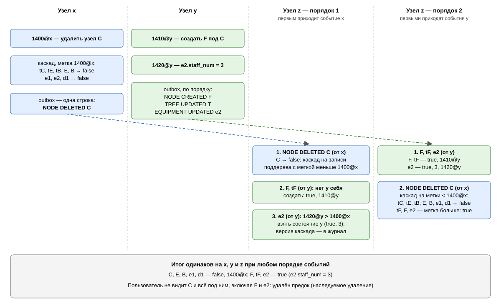
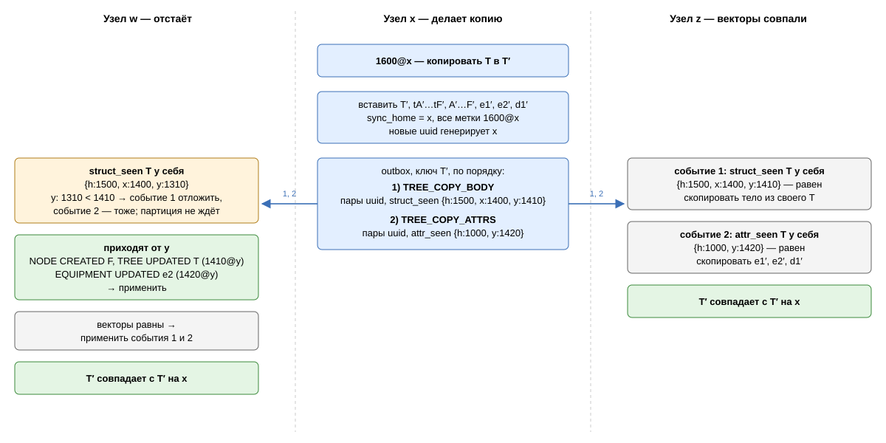

# Живой пример — дерево ОШС

Сквозной пример тиражирования дерева ОШС ПК ПВОД на модели базы (схема `oshs`): десять сценариев подряд — по дереву (1–6) и по одному узлу и его спискам (7–10), в каждом — что пишется в базу узла, что уходит в теле события и какие решения принимает слияние на получателе. Правила — [Правила слияния информационных объектов](../02_Правила%20слияния%20информационных%20объектов.md), решения по сущности — [Примеры слияния — дерево ОШС](02_Примеры%20слияния%20—%20дерево%20ОШС.md). Значения uuid, меток и полей в примере условные.

## 1. Обозначения

- **Узлы:** `h` — домашний узел дерева, `x` и `y` — правят дерево, `z` — только получает, `w` — получает с отставанием (сценарий 6).
- **uuid:** `T` — дерево, `A`…`F` — узлы (`toss_object`), `tA`…`tF` — их строки в `toss_tree`, `e1`…`e4` — вооружение, `d1`, `d2` — дислокация, `p2`, `p3` — должности, `S1`, `S2`, `W1`, `P1`, `K1` — записи классификаторов. В базе это колонки `*_uuid`.
- **Локальные ключи** `*_id` на каждом узле свои: у узла `B` на `h` — `oss_object_id = 2`, на `x` — `7`, на `y` — `4`. Между узлами ходят только uuid, получатель находит свой `id` по uuid.
- **Метка HLC:** `1200@x` — время 1200, счётчик 0, узел `x`.
- **Признак удаления** `flag_actual_action`: `true` — запись действует, `false` — удалена.

## 2. Модель

### 2.1. Колонки, которые участвуют в примере

| Таблица | Объект | Бизнес-колонки примера | Колонки версии |
|---|---|---|---|
| `tconstructed_tree_descript` | дерево (описание) | `constructed_tree_descript_name`, `flag_actual_action` | `sync_home`, `sync_node`, `sync_hlc_wall`, `sync_hlc_counter`, `field_stamps` |
| `toss_tree` | дерево (строки) | `oss_tree_pid`, `oss_object_id`, `oss_tree_order`, `level_maintenance_forces_id`, `flag_actual_action` | `sync_stamps` — `@place` (признак и родитель), `@order` (уровень и порядок) |
| `toss_object` | узел | `oss_object_num`, `oss_object_staff_num`, `flag_actual_action` | `sync_home`, `sync_node`, `sync_hlc_wall`, `sync_hlc_counter`, `field_stamps` |
| `toss_tree_equipment` | элемент вооружения | `oss_tree_id`, `oss_tree_equipment_staff_num`, `flag_actual_action` | `sync_home`, `sync_node`, `sync_hlc_wall`, `sync_hlc_counter` |
| `tpermanent_disloc_unit` | элемент дислокации | `oss_tree_id`, `permanent_disloc_unit_x`, `permanent_disloc_unit_y`, `flag_actual_action` | `sync_home`, `sync_node`, `sync_hlc_wall`, `sync_hlc_counter` |

Служебные таблицы СПО:

| Таблица | Что хранит |
|---|---|
| часы HLC | одна строка — последняя выданная метка узла |
| `struct_seen`, `attr_seen` | по каждому дереву и узлу-источнику — последняя метка применённого изменения: структура и узлы / элементы списков |
| отложенные события | события, которые пока нельзя применить |
| outbox | строки событий к отправке |
| журнал отброшенных правок | перезаписанные значения в режиме «а» |

### 2.2. Тело события

Все события сущности идут в один топик, ключ сообщения — uuid дерева. Заголовки — `x-origin` (узел, где возникло событие), `x-message-id` и остальные по ADR-0022.

```text
OssTreeEvent
  type        TREE | NODE | EQUIPMENT | DISLOC | POST | TREE_COPY_BODY | TREE_COPY_ATTRS
  action      CREATED | UPDATED | DELETED
  tree_uuid   uuid дерева (= ключ сообщения)
  payload     oneof: tree | node | equipment | disloc | post | copy_body | copy_attrs

Tree        uuid, home, version, name, flag_actual_action, field_stamps,
            rows: [TreeRow]
TreeRow     uuid, parent_uuid, object_uuid, order, level_uuid, flag_actual_action,
            place_stamp, order_stamp
Node        uuid, home, version, oss_object_num, oss_object_staff_num, …,
            flag_actual_action, field_stamps
Equipment   uuid, home, version, tree_row_uuid, staff_num, …, flag_actual_action
Disloc      uuid, home, version, tree_row_uuid, x, y, …, flag_actual_action
Post        uuid, home, version, tree_row_uuid, flag_actual_action,
            form oneof: union { staff_post_united_uuid, categor_person_uuid, staff_num, … }
                      | union_for { categor_person_uuid, val }
CopyBody    source_uuid, pairs: [old_uuid → new_uuid], struct_seen: {узел: метка}
CopyAttrs   source_uuid, pairs: [old_uuid → new_uuid], attr_seen: {узел: метка}
```

Ссылки — только uuid (`parent_uuid`, `object_uuid`, `level_uuid`, `tree_row_uuid`); `full_name` и `full_sname` не передаются — получатель вычисляет их сам.

### 2.3. Общие шаги

- **Своё изменение** — одна транзакция: бизнес-колонки, новая метка из часов HLC, колонки версии, строка outbox.
- **Приём события** — одна транзакция: найти записи по uuid, слить по правилам объекта, перевести uuid в свои `id`, пересчитать `full_name`, обновить часы HLC (метка не меньше пришедшей), `struct_seen` или `attr_seen`, проверить итог дерева. Применение пришедшего события строку outbox не создаёт.

## 3. Исходное состояние

```text
T «ОШС-1»  (домашний узел h)
└─ A
   ├─ B   порядок 1   вооружение e1, дислокация d1
   └─ C   порядок 2
      └─ E   порядок 1   вооружение e2
```

На всех узлах одинаково:

| Запись | Значения | Метки |
|---|---|---|
| `toss_tree` `tB` | родитель `tA`, порядок 1, уровень `L1`, `flag_actual_action = true` | `@place 1000@h`, `@order 1000@h` |
| `toss_object` `B` | `oss_object_num = 3`, `oss_object_staff_num = 10`, `true` | все поля `1000@h` |
| `toss_tree_equipment` `e2` | строка `tE`, `staff_num = 1`, `true` | версия `1000@h` |

Остальные записи — так же, с метками `1000@h`. `struct_seen` и `attr_seen` дерева `T`: `{h: 1000}`.

## 4. Сценарий 1. Y создаёт узел D под A

### 4.1. База на y — одна транзакция

| Таблица | Действие | Значения |
|---|---|---|
| часы HLC | обновить | `1100@y` |
| `toss_object` | вставить `D` | `oss_object_num = 4`, `oss_object_staff_num = 8`, `flag_actual_action = true`, `sync_home = y`, `sync_node = y`, `sync_hlc = 1100/0`, `field_stamps` — у каждого поля `1100@y` |
| `toss_tree` | вставить `tD` | `oss_tree_pid` = свой `id` строки `tA`, `oss_object_id` = свой `id` `D`, порядок 3, уровень `L1`, `true`, `sync_stamps = {"@place": "1100@y", "@order": "1100@y"}` |
| `tconstructed_tree_descript` | обновить `T` | `sync_node = y`, `sync_hlc = 1100/0` — версия дерева = наибольшая метка его единиц |
| `struct_seen` | обновить | `T`: `y = 1100` |
| outbox | две строки по порядку | 1) `NODE CREATED D`; 2) `TREE UPDATED T` |

### 4.2. Тела событий

```text
1)  type NODE   action CREATED   tree_uuid T
    node { uuid D, home y, version 1100@y,
           oss_object_num 4, oss_object_staff_num 8, flag_actual_action true,
           field_stamps { oss_object_num: [1100@y], oss_object_staff_num: [1100@y],
                          flag_actual_action: [1100@y], … } }

2)  type TREE   action UPDATED   tree_uuid T
    tree { uuid T, home h, version 1100@y, name «ОШС-1», flag_actual_action true,
           field_stamps { name: [1000@h], flag_actual_action: [1000@h] },
           rows [ { tA … 1000@h }, { tB … 1000@h }, { tC … 1000@h }, { tE … 1000@h },
                  { uuid tD, parent_uuid tA, object_uuid D, order 3, level_uuid L1,
                    flag_actual_action true, place_stamp 1100@y, order_stamp 1100@y } ] }
```

### 4.3. Решения на x (и так же на h, z)

| Шаг | Решение |
|---|---|
| событие 1 | записи с uuid `D` нет → создать `toss_object` со своим `id` (на `x` — `31`), колонки версии и `field_stamps` — из тела |
| событие 2, описание | метки полей равны своим → без изменений |
| событие 2, строки `tA`, `tB`, `tC`, `tE` | метки `@place`, `@order` равны своим → без изменений |
| событие 2, строка `tD` | строки нет → вставить: `parent_uuid tA` → свой `id` строки `tA`, `object_uuid D` → `31`; вычислить `full_name` |
| версия дерева | `1100@y` |
| служебное | часы HLC `x` — не меньше `1100`; `struct_seen` `T`: `y = 1100`; проверка итога дерева — циклов нет |

Если бы событие 2 пришло раньше события 1, строку `tD` не на что сослать — событие откладывается до прихода узла `D`.

## 5. Сценарий 2. X и Y параллельно правят узел B

X ставит номер 5 (`1200@x`). Y, не видя этого, ставит номер 7 и численность 12 (`1210@y`).

### 5.1. База после своих изменений

| | на x | на y |
|---|---|---|
| `oss_object_num` | 5 | 7 |
| `oss_object_staff_num` | 10 | 12 |
| `field_stamps` | `num: 1200@x`, `staff_num: 1000@h` | `num: 1210@y`, `staff_num: 1210@y` |
| версия `B` | `1200@x` | `1210@y` |
| outbox | `NODE UPDATED B` | `NODE UPDATED B` |

### 5.2. Тела событий

```text
от x:  type NODE  action UPDATED  tree_uuid T
       node { uuid B, home h, version 1200@x, oss_object_num 5, oss_object_staff_num 10,
              flag_actual_action true,
              field_stamps { oss_object_num: [1200@x], oss_object_staff_num: [1000@h], … } }

от y:  type NODE  action UPDATED  tree_uuid T
       node { uuid B, home h, version 1210@y, oss_object_num 7, oss_object_staff_num 12,
              flag_actual_action true,
              field_stamps { oss_object_num: [1210@y], oss_object_staff_num: [1210@y], … } }
```

### 5.3. Решения по единицам

На `x`, получив событие от `y`:

| Единица | У себя | В событии | Решение |
|---|---|---|---|
| `oss_object_num` | 5, `1200@x` | 7, `1210@y` | взять 7; в журнал: узел `B`, единица `oss_object_num`, перезаписано 5, проиграла `1200@x`, победила `1210@y`, `x-message-id` события |
| `oss_object_staff_num` | 10, `1000@h` | 12, `1210@y` | взять 12 |
| `flag_actual_action` | `true`, `1000@h` | `true`, `1000@h` | без изменений |

На `y`, получив событие от `x`: `oss_object_num` — у себя `1210@y` больше `1200@x`, оставить 7, в журнал — проигравшее значение 5 с узла `x`; `oss_object_staff_num` — у себя `1210@y` больше `1000@h`, оставить 12.

На `h` и `z` в любом порядке прихода: номер 7, численность 12, одна запись в журнал о значении 5. Версия `B` на всех узлах — `1210@y`.

## 6. Сценарий 3. X переносит B под C, Y меняет у B порядок

X переносит `B` под `C` (`1300@x`). Y ставит `B` порядок 2 и уровень `L2` (`1310@y`).

| | на x | на y |
|---|---|---|
| `toss_tree` `tB` | `oss_tree_pid` = строка `tC`, порядок 1, `L1` | родитель `tA`, порядок 2, `L2` |
| `sync_stamps` `tB` | `@place 1300@x`, `@order 1000@h` | `@place 1000@h`, `@order 1310@y` |
| outbox | `TREE UPDATED T` (полное состояние, строка `tB` изменена) | `TREE UPDATED T` |

Тело — как в п. 4.2; отличается строка `tB`:

```text
от x:  { uuid tB, parent_uuid tC, object_uuid B, order 1, level_uuid L1, flag_actual_action true,
         place_stamp 1300@x, order_stamp 1000@h }
от y:  { uuid tB, parent_uuid tA, object_uuid B, order 2, level_uuid L2, flag_actual_action true,
         place_stamp 1000@h, order_stamp 1310@y }
```

Решения на `z` по строке `tB` (в любом порядке):

| Единица | Версии | Решение |
|---|---|---|
| `@place` | `1000@h` (родитель `tA`), `1300@x` (родитель `tC`) | `tC` от `x` |
| `@order` | `1000@h` (1, `L1`), `1310@y` (2, `L2`) | 2, `L2` от `y` |

Остальные строки — метки равны, без изменений. Пересчитать `full_name` у `B`; проверка итога — циклов нет; `struct_seen` `T`: `x = 1300`, `y = 1310`. Итог на всех узлах:

```text
T
└─ A
   └─ C
      ├─ E   порядок 1   e2
      └─ B   порядок 2   e1, d1   (уровень L2)
```

## 7. Сценарий 4. X удаляет C, Y параллельно создаёт F под C и правит e2

X удаляет `C` (`1400@x`) — с ним поддерево `E`, `B` и элементы `e1`, `e2`, `d1`. Y этого ещё не видел: создаёт `F` под `C` (`1410@y`) и ставит у `e2` численность 3 (`1420@y`).



### 7.1. База на x

| Запись | Изменение | Почему |
|---|---|---|
| `toss_object` `C` | `flag_actual_action = false`, метка `1400@x` | удаление |
| `toss_tree` `tC`, `tE`, `tB` | `flag_actual_action = false`, `@place 1400@x` | каскад: их метки `@place` (`1000@h`, `1000@h`, `1300@x`) меньше `1400@x` |
| `toss_object` `E`, `B` | `false`, метка признака `1400@x` | каскад |
| `e1`, `e2`, `d1` | `false`, версия `1400@x` | каскад: версии `1000@h` меньше |
| outbox | **одна** строка `NODE DELETED C` | каскад событий не создаёт |

```text
type NODE  action DELETED  tree_uuid T
node { uuid C, home h, version 1400@x, flag_actual_action false, …,
       field_stamps { flag_actual_action: [1400@x], … } }
```

### 7.2. База на y

| Запись | Изменение |
|---|---|
| `toss_object` `F` | вставить, `sync_home = y`, метки `1410@y` |
| `toss_tree` `tF` | вставить, родитель `tC`, `@place 1410@y`, `@order 1410@y` |
| `e2` | `staff_num = 3`, версия `1420@y` |
| outbox | `NODE CREATED F`, `TREE UPDATED T`, `EQUIPMENT UPDATED e2` |

### 7.3. Решения на z при двух порядках прихода

Правило каскада: признак удаления родителя переходит на запись, только если её метка (у объекта целиком — версия) **меньше** метки удаления. Поэтому итог не зависит от порядка.

| Запись | Сначала событие x, потом y | Сначала события y, потом x |
|---|---|---|
| `C` | `false`, `1400@x` | `false`, `1400@x` |
| `tC`, `tE`, `tB`, `E`, `B` | каскад: `false`, `1400@x` | каскад: `false`, `1400@x` |
| `e1`, `d1` | каскад: `false`, `1400@x` | каскад: `false`, `1400@x` |
| `tF`, `F` | созданы позже каскада: `true`, `1410@y` | созданы раньше; при каскаде метка `1410@y` больше `1400@x` — признак сохранён: `true`, `1410@y` |
| строки `tC`, `tE`, `tB` в событии дерева от y | у себя `1400@x` больше, без изменений | — |
| `e2` | у себя `false`, `1400@x`; пришло `1420@y` — больше: взять состояние y (`true`, `staff_num = 3`); в журнал — проигравшая версия каскада | у себя `1420@y`; при каскаде больше `1400@x` — признак сохранён |
| **итог** | `C`, `E`, `B`, `e1`, `d1` — `false`; `F`, `tF`, `e2` — `true`, `e2.staff_num = 3` | то же |

**Что видит пользователь** на всех узлах: `C` и всё под ним скрыто, включая `F` и `e2`, — их признак `true`, но удалён предок (наследуемое удаление).

### 7.4. Правка с меткой меньше метки удаления

Если бы правка `e2` на `y` получила метку `1390@y` — меньше `1400@x` (часы узлов расходятся):

| Узел | Порядок прихода | `e2` |
|---|---|---|
| `z` | сначала правка, потом удаление `C` | правка применена (`staff_num = 3`); каскад: `1390@y` меньше `1400@x` → `false`, версия `1400@x` |
| `w` | сначала удаление `C`, потом правка | каскад: `false`, версия `1400@x`; правка `1390@y` старее → пропущена (`staff_num = 1`) |

Пока `C` удалён, пользователь `e2` не видит нигде. После восстановления `C` на `z` у `e2` численность 3, на `w` — 1; выровняет следующая правка `e2` или повторная синхронизация.

## 8. Сценарий 5. H восстанавливает C

H снимает удаление с `C` (`1500@h`). Восстановление выполняется редко и не средствами интерфейса.

| Запись на h | Изменение |
|---|---|
| `toss_object` `C` | `flag_actual_action = true`, метка `1500@h` |
| каскад: `tC`, `tE`, `tB`, `tF`, `E`, `B`, `F`, `e1`, `e2`, `d1` | `true`, метка `1500@h` — у всех метки меньше `1500@h` |
| outbox | одна строка `NODE UPDATED C` |

На `x`, `y`, `z` — то же по событию: восстановление каскадом по тому же правилу. Итог:

```text
T
└─ A
   └─ C
      ├─ E   порядок 1   e2 (staff_num 3)
      ├─ B   порядок 2   e1, d1
      └─ F   порядок 3
```

Восстановлено всё поддерево, вместе с параллельно созданным `F` и правкой `e2`. Записи поддерева, удалённые по отдельности раньше (их метка меньше `1500@h`), тоже вернутся: признак удаления один, отдельного собственного признака у записи нет. `struct_seen` `T` на всех узлах: `{h: 1500, x: 1400, y: 1410}`; `attr_seen`: `{h: 1000, y: 1420}`.

## 9. Сценарий 6. X копирует T в T′

X копирует дерево `T` в новое `T′` (`1600@x`). Новые uuid генерирует X.



### 9.1. База на x

| Таблица | Действие |
|---|---|
| `tconstructed_tree_descript` | вставить `T′`: имя из `T`, `sync_home = x`, метки `1600@x` |
| `toss_object`, `toss_tree` | вставить `A′`…`F′`, `tA′`…`tF′`: значения из `T`, ссылки — на новые записи, `sync_home = x`, все метки `1600@x` |
| `toss_tree_equipment`, `tpermanent_disloc_unit` | вставить `e1′`, `e2′`, `d1′` так же |
| outbox | две строки: `TREE_COPY_BODY`, `TREE_COPY_ATTRS`, ключ — `T′` |

### 9.2. Тела событий

```text
1)  type TREE_COPY_BODY  action CREATED  tree_uuid T′
    copy_body { source_uuid T, version 1600@x,
                pairs [ T→T′, tA→tA′, …, tF→tF′, A→A′, …, F→F′ ],
                struct_seen { h: 1500, x: 1400, y: 1410 } }

2)  type TREE_COPY_ATTRS  action CREATED  tree_uuid T′
    copy_attrs { source_uuid T, version 1600@x,
                 pairs [ e1→e1′, e2→e2′, d1→d1′ ],
                 attr_seen { h: 1000, y: 1420 } }
```

### 9.3. Решения на z — векторы совпали

| Шаг | Решение |
|---|---|
| событие 1 | свой `struct_seen` `T` = `{h: 1500, x: 1400, y: 1410}` — равен присланному → скопировать из своего `T` описание, строки и узлы по парам; `sync_home = x`, все метки `1600@x`; свои `id` |
| событие 2 | свой `attr_seen` `T` = `{h: 1000, y: 1420}` — равен → скопировать `e1′`, `e2′`, `d1′` |
| итог | `T′` на `z` совпадает с `T′` на `x` записью в запись |

### 9.4. Решения на w — отставание

`w` ещё не получил события `y` о создании `F` и правке `e2`: у него `struct_seen` `T` = `{h: 1500, x: 1400, y: 1310}`.

| Шаг | Решение |
|---|---|
| событие 1 | `y: 1310` меньше `1410` → отложить в таблицу отложенных событий; партицию не задерживать |
| событие 2 | идёт после события 1 → тоже отложить |
| приходят `NODE CREATED F`, `TREE UPDATED T` (`1410@y`) | применить; `struct_seen` `y = 1410` — равен → применить событие 1 |
| приходит `EQUIPMENT UPDATED e2` (`1420@y`) | применить; `attr_seen` `y = 1420` — равен → применить событие 2 |
| итог | `T′` на `w` совпадает с `T′` на `x` |

## 10. Сценарий 7. X редактирует узел D

Узел `D` создан на `y` (сценарий 1), его домашний узел — `y`; править его можно на любом узле. Было: `oss_object_num = 4`, `oss_object_personal_staff = 20`, `specification` — `S1`, `oss_object_staff_num = 8`. X меняет три атрибута (`1700@x`).

### 10.1. База на x — одна транзакция

| Таблица | Изменение |
|---|---|
| `toss_object` `D` | `oss_object_num = 6`, `oss_object_personal_staff = 18`, `specification_id` = свой `id` записи `S2`; `sync_node = x`, `sync_hlc = 1700/0` |
| `field_stamps` `D` | `oss_object_num`, `oss_object_personal_staff`, `specification` — `1700@x`; остальные поля — как были (`1100@y`) |
| `toss_tree` `tD` | пересчитан `full_name` — локально, в событие не входит |
| `struct_seen` | `T`: `x = 1700` |
| outbox | одна строка `NODE UPDATED D`; дерево не менялось — события дерева нет |

### 10.2. Тело события

```text
type NODE  action UPDATED  tree_uuid T
node { uuid D, home y, version 1700@x,
       oss_object_num 6, oss_object_personal_staff 18, specification_uuid S2,
       oss_object_staff_num 8, flag_actual_action true,
       field_stamps { oss_object_num: [1700@x], oss_object_personal_staff: [1700@x],
                      specification: [1700@x], oss_object_staff_num: [1100@y],
                      flag_actual_action: [1100@y], … } }
```

### 10.3. Решения на z

| Единица | У себя | В событии | Решение |
|---|---|---|---|
| `oss_object_num` | 4, `1100@y` | 6, `1700@x` | взять 6 |
| `oss_object_personal_staff` | 20, `1100@y` | 18, `1700@x` | взять 18 |
| `specification` | `S1`, `1100@y` | `S2`, `1700@x` | взять: uuid `S2` → свой `specification_id` |
| остальные поля, признак удаления | `1100@y` | `1100@y` | без изменений |

Пересчитать `full_name` строки `tD`; `struct_seen` `T`: `x = 1700`. Записи `S2` у получателя нет — событие уходит в DLQ, узел остаётся в прежнем состоянии до повторной обработки.

## 11. Сценарий 8. Y добавляет узлу D элементы списков

Y добавляет узлу `D` вооружение `e3`, должность `p2` и дислокацию `d2` (`1710@y`). Параллельно X добавляет узлу `D` вооружение `e4` того же типа `W1` (`1715@x`).

### 11.1. База на y — одна транзакция

| Таблица | Вставка |
|---|---|
| `toss_tree_equipment` `e3` | `oss_tree_id` = свой `id` строки `tD`; `constructed_tree_descript_id`, `oss_object_id` — свои `id` `T` и `D`; `wmse_equipment_list_id` = свой `id` `W1`; `oss_tree_equipment_staff_num = 2`; `true`; `sync_home = y`, версия `1710@y` |
| `tstaff_post_union` `p2` | `oss_tree_id` = строка `tD`; `staff_post_united_id` = `P1`, `categor_person_id` = `K1`; `staff_post_union_staff_num = 1`; `true`; `sync_home = y`, версия `1710@y` |
| `tpermanent_disloc_unit` `d2` | `oss_tree_id` = строка `tD`; `permanent_disloc_unit_x = 55.75`, `_y = 37.61`; `true`; `sync_home = y`, версия `1710@y` |
| `attr_seen` | `T`: `y = 1710` |
| outbox | три строки: `EQUIPMENT CREATED e3`, `POST CREATED p2`, `DISLOC CREATED d2` |

### 11.2. Тела событий

```text
type EQUIPMENT  action CREATED  tree_uuid T
equipment { uuid e3, home y, version 1710@y, tree_row_uuid tD,
            wmse_equipment_list_uuid W1, staff_num 2, flag_actual_action true, … }

type POST  action CREATED  tree_uuid T
post { uuid p2, home y, version 1710@y, tree_row_uuid tD, flag_actual_action true,
       union { staff_post_united_uuid P1, categor_person_uuid K1, staff_num 1, … } }

type DISLOC  action CREATED  tree_uuid T
disloc { uuid d2, home y, version 1710@y, tree_row_uuid tD,
         x 55.75, y 37.61, flag_actual_action true, … }
```

### 11.3. Решения на z

| Событие | Решение |
|---|---|
| `EQUIPMENT CREATED e3` | записи `e3` нет → вставить; `tree_row_uuid tD` → свой `oss_tree_id`; `constructed_tree_descript_id` и `oss_object_id` — из строки `tD`; `W1` → свой `id` |
| `POST CREATED p2` | записи нет → форма `union` → вставить в `tstaff_post_union`; `P1`, `K1` → свои `id` |
| `DISLOC CREATED d2` | записи нет → вставить в `tpermanent_disloc_unit` |
| служебное | `attr_seen` `T`: `y = 1710` |

Строки `tD` у получателя ещё нет (событие дерева не дошло) — события элементов откладываются до её прихода.

### 11.4. Параллельное добавление

`e3` с `y` и `e4` с `x` — разные элементы (разные uuid): после обмена у `D` на всех узлах два элемента вооружения типа `W1`. Если правило СПО запрещает два элемента одного типа у узла, проверка итога помечает узел «нарушено правило»; исправляет человек — удалив лишний элемент или слив их в один.

## 12. Сценарий 9. Редактирование элементов списков

### 12.1. Правка без параллельной

X ставит у `e3` численность 3 (`1720@x`): в базе на `x` — `oss_tree_equipment_staff_num = 3`, версия `1720@x`; outbox `EQUIPMENT UPDATED e3` с полным состоянием элемента. На `z`: версия `1720@x` больше `1710@y` → заменить элемент целиком; `attr_seen` `T`: `x = 1720`.

### 12.2. Параллельная правка одного элемента

X ставит у `e3` численность 4 (`1730@x`), Y, не видя этого, — индекс `oss_tree_equipment_staff_index = А` (`1735@y`). Элемент сливается целиком.

| | на x | на y |
|---|---|---|
| после своей правки | `staff_num 4`, индекс пусто, `1730@x` | `staff_num 3`, индекс `А`, `1735@y` |
| пришло событие другого | `1735@y` больше → взять элемент y целиком: `staff_num 3`, `А`; в журнал — отброшенная версия `1730@x` с полным состоянием | `1730@x` меньше → оставить свой; в журнал — отброшенная версия `1730@x` |

На всех узлах: `staff_num 3`, индекс `А`. Численность 4 с `x` осталась только в журнале.

### 12.3. Должность в форме union_for

Должность `p3` у узла `B` записана в `tstaff_post_union_for` (форма выбрана программно по типу узла). X меняет `staff_post_union_for_val` с 2 на 5 (`1740@x`):

```text
type POST  action UPDATED  tree_uuid T
post { uuid p3, home h, version 1740@x, tree_row_uuid tB, flag_actual_action true,
       union_for { categor_person_uuid K1, val 5 } }
```

На `z`: версия новее → заменить строку `p3` в `tstaff_post_union_for` целиком. Форма в событии всегда совпадает с таблицей, где элемент лежит у получателя: форма элемента не меняется.

## 13. Сценарий 10. Удаление элементов списков

### 13.1. Удаление без параллельной правки

X удаляет дислокацию `d2` (`1750@x`): в базе на `x` — `flag_actual_action = false`, версия `1750@x`, запись остаётся; outbox `DISLOC DELETED d2` с полным состоянием элемента. На `z`: версия новее → заменить элемент; `d2` скрыт у пользователя на всех узлах.

### 13.2. Удаление и параллельная правка

X удаляет должность `p2` (`1760@x`). Y, не видя этого, меняет у `p2` численность на 2.

| Метка правки Y | Итог на всех узлах | В журнале |
|---|---|---|
| `1755@y` (меньше) | `p2` удалена (`false`, `1760@x`) | версия Y с численностью 2 |
| `1765@y` (больше) | `p2` действует (`true`, численность 2, `1765@y`) — удаление проиграло | версия X с признаком `false` |

Порядок прихода событий на итог не влияет: решает только версия элемента.

### 13.3. Вернуть элемент

- **Восстановить удалённый** — явная правка признака: `flag_actual_action = true`, новая версия, событие `POST UPDATED p2`; сливается как любая правка элемента.
- **Добавить заново** такую же должность — новый элемент с новым uuid (сценарий 8); удалённый `p2` остаётся в базе с признаком `false`.

## 14. Сводка решений при слиянии

| Объект, единица | Сравнение | Победитель | Что ещё |
|---|---|---|---|
| поле узла или описания | метки поля | большая метка | проигравшее значение — в журнал |
| `@place` строки дерева | метки `@place` | большая метка — признак и родитель вместе | пересчёт `full_name`, проверка цикла |
| `@order` строки дерева | метки `@order` | большая метка — уровень и порядок вместе | равные порядки — по uuid |
| элемент вооружения или дислокации | версии элемента | большая версия — весь элемент | проигравшая версия — в журнал |
| удаление узла | метка признака | большая метка | каскад на записи с меньшей меткой |
| видимость | признак записи и предков | — | скрыта, если удалена она или любой предок |
| копия | `struct_seen`, `attr_seen` получателя и события | — | равны — копировать; отстаёт — отложить |

## Связанные заметки

- [Примеры слияния — дерево ОШС](02_Примеры%20слияния%20—%20дерево%20ОШС.md)
- [Правила слияния информационных объектов](../02_Правила%20слияния%20информационных%20объектов.md)
- [СПО](../01_СПО.md)
- [ПК ПВОД](01_ПК%20ПВОД.md)
- [ADR-0092 Тиражирование данных между узлами — перечень топиков, полное состояние, слияние, повторная синхронизация](../../90_ADR/ADR-0092%20Тиражирование%20данных%20между%20узлами%20—%20перечень%20топиков,%20полное%20состояние,%20слияние,%20повторная%20синхронизация.md)
- [ADR-0093 Слияние по полям — метки единиц слияния в jsonb, описание в опциях proto](../../90_ADR/ADR-0093%20Слияние%20по%20полям%20—%20метки%20единиц%20слияния%20в%20jsonb,%20описание%20в%20опциях%20proto.md)
- [ADR-0021 Гарантии доставки межузлового обмена, сроки хранения и DLQ](../../90_ADR/ADR-0021%20Гарантии%20доставки%20межузлового%20обмена,%20сроки%20хранения%20и%20DLQ.md)
- [ADR-0007 Публикация событий СПО — outbox, CDC или публикатор](../../90_ADR/ADR-0007%20Публикация%20событий%20СПО%20—%20outbox,%20CDC%20или%20публикатор.md)
- [BL-080 Именование топиков СПО — name_spo.name_io.action](../../80_Базис/BL-080%20Именование%20топиков%20СПО%20—%20name_spo.name_io.action.md)
- [BL-134 Псевдоним узла — переменная окружения AUTOMATIZATION_NODE_NAME](../../80_Базис/BL-134%20Псевдоним%20узла%20—%20переменная%20окружения%20AUTOMATIZATION_NODE_NAME.md)
