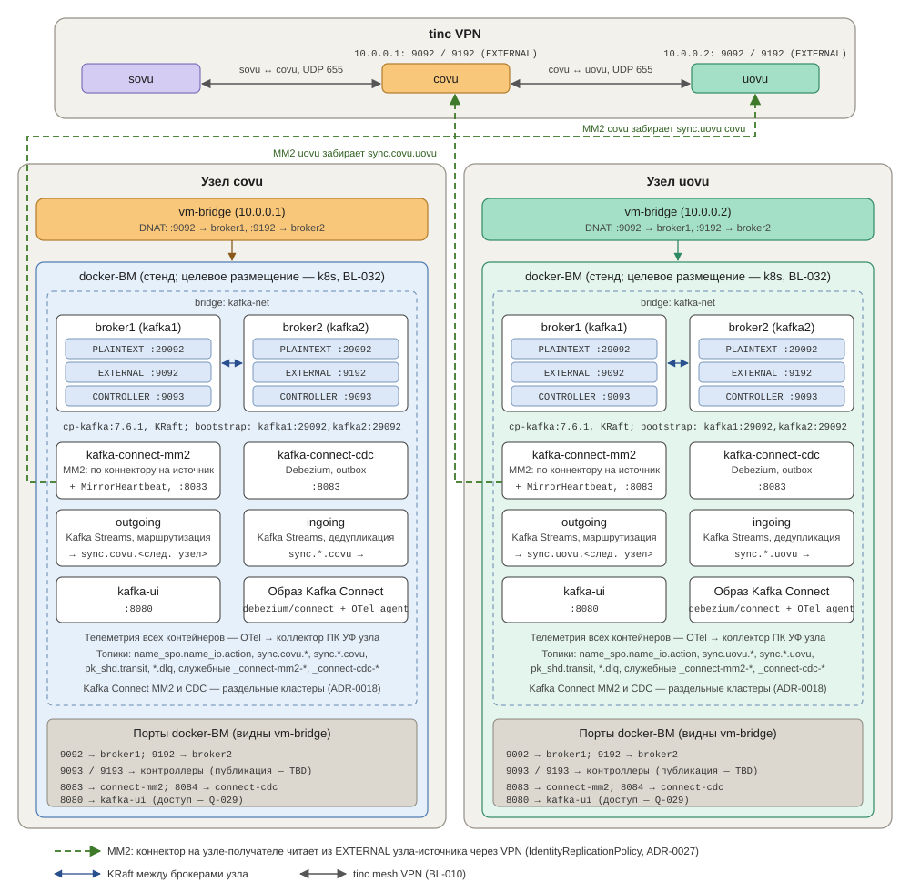

# Конфигурация Kafka на узле

> Тестовая конфигурация для подтверждения концепта, а не стенд (со слов архитектора, 2026-11-04). Проверенная версия — `tmp/docker-compose.yml`: брокеры `cp-kafka:7.6.1`, Kafka Connect закомментирован для локального теста; прежняя версия с Kafka Connect — `cp-kafka:7.6.0` / `cp-kafka-connect:7.6.0`, один кластер Connect, MM2 с `DefaultReplicationPolicy` (результаты — [Проверка репликации MirrorMaker 2](05_Проверка%20репликации%20MirrorMaker%202.md)).
>
> **Листинги ниже приведены к принятым решениям (2026-11-04, по просьбе архитектора) и на стенде целиком не проверялись.** Отличия от проверенной версии — раздел 8; что проверить — «Расхождения с базисом». Полная предполагаемая конфигурация ПК ШД — [Схема и состав ПК ШД](02_Схема%20и%20состав%20ПК%20ШД.md).

Внутри каждого узла автоматизации на выделенной ВМ разворачивается кластер Kafka, два кластера Kafka Connect (MM2 и CDC), приложения Outgoing и Ingoing на Kafka Streams и Kafka UI. На стенде всё поднимается через **docker-compose**; целевое размещение — k8s ([BL-032](../../80_Базис/BL-032%20Kafka%20ПК%20ШД%20размещается%20в%20k8s.md)). Ниже приведены конфигурационные файлы и пояснения к ним.

## 1. Состав компонентов

- **Kafka** — два брокера `confluentinc/cp-kafka:7.6.1` в режиме **KRaft** (без ZooKeeper), [BL-042](../../80_Базис/BL-042%20Образ%20Kafka%20—%20confluentinc%20cp-kafka%207.6.1.md). Итоговое число брокеров — Q-014.
- **Kafka Connect MM2** — кластер для MM2-коннекторов: по `MirrorSourceConnector` на каждый узел-источник и `MirrorHeartbeatConnector` ([ADR-0018](../../90_ADR/ADR-0018%20Раздельные%20кластеры%20Kafka%20Connect%20для%20MM2%20и%20Debezium.md), [ADR-0020](../../90_ADR/ADR-0020%20MM2%20—%20heartbeats%20включены,%20checkpoints%20не%20используются.md)).
- **Kafka Connect CDC** — кластер для коннекторов Debezium (outbox СПО).
- Оба кластера Connect — из своего образа: `quay.io/debezium/connect` + слой с OTel Java agent ([ADR-0013](../../90_ADR/ADR-0013%20Образ%20Kafka%20Connect%20—%20debezium%20connect.md), [ADR-0019](../../90_ADR/ADR-0019%20OTel%20Java%20agent%20в%20образе%20Kafka%20Connect%20—%20свой%20слой.md)).
- **Outgoing** и **Ingoing** — приложения Kafka Streams, свои образы на Debian 12 ([ADR-0017](../../90_ADR/ADR-0017%20Приложения%20Kafka%20Streams%20ПК%20ШД.md)).
- **Kafka UI** — веб-интерфейс администратора ([ADR-0014](../../90_ADR/ADR-0014%20Kafka%20UI%20в%20составе%20ПК%20ШД.md)).
- OTel-коллектор в состав не входит — это ПК УФ своего узла ([BL-035](../../80_Базис/BL-035%20Логирование%20—%20ПК%20УФ.md), [BL-044](../../80_Базис/BL-044%20ПК%20УФ%20на%20каждом%20узле%20свой.md)).

## 2. Схема



## 3. Файлы конфигурации

Все файлы размещены в каталоге `/var/opt/kafka-compose/` (путь может быть изменён).

### 3.1. `.env` — переменные окружения

```env
NODE_ALIAS=uovu              # псевдоним текущего узла: snake_case без точек (BL-082)
CLUSTER_ID=MkU3OEVBNTcwNTJENDM2Qk   # идентификатор KRaft-кластера (генерируется один раз)
VPN_IP=10.0.0.2              # VPN-адрес этого узла (внешний адрес для других узлов)
REMOTE_VPN_IP=10.0.0.1       # VPN-адрес узла-источника, с которого принимаем
REMOTE_ALIAS=covu            # псевдоним узла-источника
CONNECT_IMAGE=pk-shd/connect:TBD          # свой образ: debezium/connect + OTel Java agent (ADR-0019)
OUTGOING_IMAGE=pk-shd/outgoing:TBD        # свой образ, Debian 12 (ADR-0017)
INGOING_IMAGE=pk-shd/ingoing:TBD          # свой образ, Debian 12 (ADR-0017)
OTEL_ENDPOINT=TBD            # коллектор ПК УФ узла (Q-047)
SYNC_RETENTION_MS=7776000000 # sync.<узел>.* у источника: предельная автономность (месяц) × 3 = 90 дней (ADR-0021, BL-083)
SYNC_IN_RETENTION_MS=259200000  # sync.*.<узел> у получателя: 3 дня (ADR-0021)
SYNC_PARTITIONS=TBD          # одинаково на обеих сторонах канала (ADR-0021)
```

### 3.2. `docker-compose.yml` — оркестрация сервисов

```yaml
version: "3.8"
networks:
   kafka-net:
       driver: bridge
       ipam:
           config:
               - subnet: 172.20.0.0/24
                 gateway: 172.20.0.1
x-kafka-env: &kafka-env
           KAFKA_PROCESS_ROLES: broker,controller
           KAFKA_CONTROLLER_QUORUM_VOTERS: 1@kafka1:9093,2@kafka2:9093
           CLUSTER_ID: ${CLUSTER_ID}
           KAFKA_LISTENER_SECURITY_PROTOCOL_MAP: PLAINTEXT:PLAINTEXT,CONTROLLER:PLAINTEXT,EXTERNAL:PLAINTEXT   # шифрование — Q-009
           KAFKA_CONTROLLER_LISTENER_NAMES: CONTROLLER
           KAFKA_INNER_BROKER_LISTENER_NAME: PLAINTEXT
           KAFKA_LOG_DIRS: /var/lib/kafka/data
           KAFKA_AUTO_CREATE_TOPICS_ENABLE: "true"        # TBD: топики sync создаются явно (create-topics.sh)
           KAFKA_OFFSETS_TOPIC_REPLICATION_FACTOR: 2
           KAFKA_TRANSACTION_STATE_LOG_REPLICATION_FACTOR: 2
           KAFKA_TRANSACTION_STATE_LOG_MIN_ISR: 2
           KAFKA_MIN_INSYNC_REPLICAS: 1                   # TBD при двух брокерах (Q-014)
x-connect-env: &connect-env
           BOOTSTRAP_SERVERS: kafka1:29092,kafka2:29092
           CONFIG_STORAGE_REPLICATION_FACTOR: 2
           OFFSET_STORAGE_REPLICATION_FACTOR: 2
           STATUS_STORAGE_REPLICATION_FACTOR: 2
           CONNECT_CONSUMER_REQUEST_TIMEOUT_MS: "60000"
           CONNECT_PRODUCER_REQUEST_TIMEOUT_MS: "60000"
           ENABLE_JOLOKIA: "false"                        # отключено (ADR-0013)
           ENABLE_APICURIO_CONVERTERS: "false"            # отключено (ADR-0013)
           KAFKA_OPTS: -javaagent:/otel/opentelemetry-javaagent.jar   # путь — TBD (ADR-0019, BL-081)
           OTEL_EXPORTER_OTLP_ENDPOINT: ${OTEL_ENDPOINT}
services:
   kafka1:
       image: confluentinc/cp-kafka:7.6.1
       container_name: kafka1
       networks:
           kafka-net:
               ipv4_address: 172.20.0.2
       restart: unless-stopped
       healthcheck:
           test: ["CMD", "kafka-cluster", "cluster-id", "--bootstrap-server", "kafka1:29092"]
           interval: 10s
           timeout: 5s
           start_period: 30s
       ports:
           - "9092:9092"      # внешний доступ (через VPN, vm-bridge)
           - "9093:9093"      # контроллер — публикация на хост TBD
       volumes:
           - /kafkadata1:/var/lib/kafka/data
       environment:
           <<: *kafka-env
           KAFKA_NODE_ID: 1
           KAFKA_LISTENERS: PLAINTEXT://:29092,CONTROLLER://:9093,EXTERNAL://:9092
           KAFKA_ADVERTISED_LISTENERS: PLAINTEXT://kafka1:29092,EXTERNAL://${VPN_IP}:9092
   kafka2:
       image: confluentinc/cp-kafka:7.6.1
       container_name: kafka2
       restart: unless-stopped
       networks:
           kafka-net:
               ipv4_address: 172.20.0.3
       healthcheck:
           test: ["CMD", "kafka-cluster", "cluster-id", "--bootstrap-server", "kafka2:29092"]
           interval: 10s
           timeout: 5s
           start_period: 30s
       ports:
           - "9192:9192"      # внешний доступ (через VPN) на второй порт
           - "9193:9093"      # контроллер — публикация на хост TBD
       volumes:
           - /kafkadata2:/var/lib/kafka/data
       environment:
           <<: *kafka-env
           KAFKA_NODE_ID: 2
           KAFKA_LISTENERS: PLAINTEXT://:29092,CONTROLLER://:9093,EXTERNAL://:9192
           KAFKA_ADVERTISED_LISTENERS: PLAINTEXT://kafka2:29092,EXTERNAL://${VPN_IP}:9192
   kafka-connect-mm2:
       image: ${CONNECT_IMAGE}
       container_name: kafka-connect-mm2
       networks:
           kafka-net:
               ipv4_address: 172.20.0.4
       depends_on:
           kafka1: { condition: service_healthy }
           kafka2: { condition: service_healthy }
       restart: unless-stopped
       healthcheck:
           test: ["CMD", "curl", "-sf", "http://localhost:8083/"]
           interval: 10s
           timeout: 5s
           retries: 15
           start_period: 60s
       ports:
           - "8083:8083"
       environment:
           <<: *connect-env
           GROUP_ID: connect-mm2-${NODE_ALIAS}
           CONFIG_STORAGE_TOPIC: _connect-mm2-configs
           OFFSET_STORAGE_TOPIC: _connect-mm2-offsets
           STATUS_STORAGE_TOPIC: _connect-mm2-status
           CONNECT_REST_ADVERTISED_HOST_NAME: kafka-connect-mm2
           OTEL_SERVICE_NAME: pk-shd-connect-mm2
   kafka-connect-cdc:
       image: ${CONNECT_IMAGE}
       container_name: kafka-connect-cdc
       networks:
           kafka-net:
               ipv4_address: 172.20.0.6
       depends_on:
           kafka1: { condition: service_healthy }
           kafka2: { condition: service_healthy }
       restart: unless-stopped
       healthcheck:
           test: ["CMD", "curl", "-sf", "http://localhost:8083/"]
           interval: 10s
           timeout: 5s
           retries: 15
           start_period: 60s
       ports:
           - "8084:8083"
       environment:
           <<: *connect-env
           GROUP_ID: connect-cdc-${NODE_ALIAS}
           CONFIG_STORAGE_TOPIC: _connect-cdc-configs
           OFFSET_STORAGE_TOPIC: _connect-cdc-offsets
           STATUS_STORAGE_TOPIC: _connect-cdc-status
           CONNECT_REST_ADVERTISED_HOST_NAME: kafka-connect-cdc
           OTEL_SERVICE_NAME: pk-shd-connect-cdc
   outgoing:
       image: ${OUTGOING_IMAGE}
       container_name: outgoing
       networks:
           kafka-net:
               ipv4_address: 172.20.0.7
       depends_on:
           kafka1: { condition: service_healthy }
           kafka2: { condition: service_healthy }
       restart: unless-stopped
       environment:                                    # имена переменных — TBD (свой код, ADR-0017)
           BOOTSTRAP_SERVERS: kafka1:29092,kafka2:29092
           APPLICATION_ID: pk-shd-outgoing
           PROCESSING_GUARANTEE: at_least_once         # ADR-0021
           NODE_ALIAS: ${NODE_ALIAS}
           ROUTING_CONFIG: /etc/pk-shd/routing.yaml    # узлы, типы, каналы, правила — Ansible (ADR-0027); формат TBD
           OTEL_EXPORTER_OTLP_ENDPOINT: ${OTEL_ENDPOINT}
           OTEL_SERVICE_NAME: pk-shd-outgoing
   ingoing:
       image: ${INGOING_IMAGE}
       container_name: ingoing
       networks:
           kafka-net:
               ipv4_address: 172.20.0.8
       depends_on:
           kafka1: { condition: service_healthy }
           kafka2: { condition: service_healthy }
       restart: unless-stopped
       environment:                                    # имена переменных — TBD
           BOOTSTRAP_SERVERS: kafka1:29092,kafka2:29092
           APPLICATION_ID: pk-shd-ingoing
           PROCESSING_GUARANTEE: at_least_once         # ADR-0021
           NODE_ALIAS: ${NODE_ALIAS}
           ROUTING_CONFIG: /etc/pk-shd/routing.yaml    # нужное узлу / транзит (ADR-0027)
           DEDUP_RETENTION_MS: ${SYNC_RETENTION_MS}    # не меньше срока у источника (ADR-0021, Q-019)
           OTEL_EXPORTER_OTLP_ENDPOINT: ${OTEL_ENDPOINT}
           OTEL_SERVICE_NAME: pk-shd-ingoing
   kafka-ui:
       image: provectuslabs/kafka-ui:v0.7.2
       container_name: kafka-ui
       networks:
           kafka-net:
               ipv4_address: 172.20.0.5
       restart: unless-stopped
       depends_on:
           kafka1: { condition: service_healthy }
           kafka2: { condition: service_healthy }
       ports:
           - "8080:8080"      # доступ администратора — Q-029
       environment:
           KAFKA_CLUSTERS_0_NAME: ${NODE_ALIAS}-local
           KAFKA_CLUSTERS_0_BOOTSTRAPSERVERS: kafka1:29092,kafka2:29092
           KAFKA_CLUSTERS_0_KRAFT: true
           KAFKA_CLUSTERS_0_KAFKACONNECT_0_NAME: connect-mm2
           KAFKA_CLUSTERS_0_KAFKACONNECT_0_ADDRESS: http://kafka-connect-mm2:8083
           KAFKA_CLUSTERS_0_KAFKACONNECT_1_NAME: connect-cdc
           KAFKA_CLUSTERS_0_KAFKACONNECT_1_ADDRESS: http://kafka-connect-cdc:8083
```

Переменные Kafka Connect — по `docker-entrypoint.sh` образа Debezium (`BOOTSTRAP_SERVERS`, `GROUP_ID`, `*_STORAGE_TOPIC`; `CONNECT_*` превращаются в свойства воркера). Имена групп, служебных топиков, `application.id` и `OTEL_SERVICE_NAME` — предложение агента, TBD ([Схема и состав ПК ШД](02_Схема%20и%20состав%20ПК%20ШД.md)).

### 3.3. `create-topics.sh` — внешние топики канала

Топики `sync` создаются явно, чтобы задать срок хранения и одинаковое число партиций на обеих сторонах канала ([ADR-0021](../../90_ADR/ADR-0021%20Гарантии%20доставки%20межузлового%20обмена,%20сроки%20хранения%20и%20DLQ.md)). Заводятся только по нужным каналам ([ADR-0027](../../90_ADR/ADR-0027%20Маршрутизация%20межузлового%20обмена%20—%20редакция%20по%20ревью.md)); в примере — канал с узлом `REMOTE_ALIAS` в обе стороны.

```bash
#!/bin/bash
set -euo pipefail
source /var/opt/kafka-compose/.env
KT="docker exec kafka1 kafka-topics --bootstrap-server kafka1:29092"
# исходящий: пишет Outgoing этого узла, забирает MM2 узла-получателя — срок = автономность × 3
$KT --create --if-not-exists --topic "sync.${NODE_ALIAS}.${REMOTE_ALIAS}" \
    --partitions "${SYNC_PARTITIONS}" --replication-factor 2 \
    --config retention.ms="${SYNC_RETENTION_MS}"
# входящий: пишет MM2 этого узла, читает Ingoing — 3 дня
$KT --create --if-not-exists --topic "sync.${REMOTE_ALIAS}.${NODE_ALIAS}" \
    --partitions "${SYNC_PARTITIONS}" --replication-factor 2 \
    --config retention.ms="${SYNC_IN_RETENTION_MS}"
# служебные топики ПК ШД (ADR-0021, ADR-0027); партиции — TBD
$KT --create --if-not-exists --topic "pk_shd.transit" --replication-factor 2
$KT --create --if-not-exists --topic "pk_shd.node.dlq" --replication-factor 2
# DLQ объектов name_spo.name_io.dlq — по списку объектов узла, TBD
```

### 3.4. `create-connector.sh` — MM2-коннектор на узле-получателе

Коннектор работает в кластере Kafka Connect MM2 **узла-получателя** и забирает ровно один топик `sync.<источник>.<этот узел>` из кластера узла-источника через VPN ([ADR-0018](../../90_ADR/ADR-0018%20Раздельные%20кластеры%20Kafka%20Connect%20для%20MM2%20и%20Debezium.md), [ADR-0027](../../90_ADR/ADR-0027%20Маршрутизация%20межузлового%20обмена%20—%20редакция%20по%20ревью.md)). На каждый узел-источник — свой коннектор.

```bash
#!/bin/bash
set -euo pipefail
source /var/opt/kafka-compose/.env
CONNECT_URL="http://localhost:8083"          # kafka-connect-mm2
CONNECTOR_NAME="mirror-${REMOTE_ALIAS}-to-${NODE_ALIAS}"
echo "await kafka connect ready"
until curl -sf "$CONNECT_URL/" > /dev/null; do
    sleep 3
done
echo "kafka connect is ready"
if curl -sf "$CONNECT_URL/connectors/$CONNECTOR_NAME" > /dev/null 2>&1; then
    echo "connector $CONNECTOR_NAME already exists, skip"
    exit 0
fi
echo "Create connector with name $CONNECTOR_NAME"
curl -sf -X POST "$CONNECT_URL/connectors" \
    -H "Content-Type: application/json" \
    -d "{
            \"name\": \"$CONNECTOR_NAME\",
            \"config\": {
                \"connector.class\": \"org.apache.kafka.connect.mirror.MirrorSourceConnector\",
                \"source.cluster.alias\": \"$REMOTE_ALIAS\",
                \"target.cluster.alias\":  \"$NODE_ALIAS\",
                \"source.cluster.bootstrap.servers\": \"${REMOTE_VPN_IP}:9092,${REMOTE_VPN_IP}:9192\",
                \"target.cluster.bootstrap.servers\": \"kafka1:29092,kafka2:29092\",
                \"topics\": \"sync.${REMOTE_ALIAS}.${NODE_ALIAS}\",
                \"replication.policy.class\": \"org.apache.kafka.connect.mirror.IdentityReplicationPolicy\",
                \"offset-syncs.topic.location\": \"target\",
                \"key.converter\": \"org.apache.kafka.connect.converters.ByteArrayConverter\",
                \"value.converter\": \"org.apache.kafka.connect.converters.ByteArrayConverter\",
                \"config.properties.exclude\": \"follower\\\\.replication\\\\.throttled\\\\.replicas, leader\\\\.replication\\\\.throttled\\\\.replicas, message\\\\.timestamp\\\\.difference\\\\.max\\\\.ms, message\\\\.timestamp\\\\.type, unclean\\\\.leader\\\\.election\\\\.enable, min\\\\.insync\\\\.replicas, retention\\\\.ms\",
                \"replication.factor\": \"1\",
                \"producer.override.compression.type\": \"lz4\",
                \"producer.override.batch.size\": \"65536\",
                \"producer.override.linger.ms\": \"5\",
                \"consumer.max.poll.records\": \"500\",
                \"sync.topic.acls.enabled\": \"false\",
                \"emit.checkpoints.enabled\": \"false\",
                \"refresh.topics.interval.seconds\": \"10\"
            }
        }"
echo ""
echo "Connector create. Check status ...."
sleep 5
curl -sf "$CONNECT_URL/connectors/$CONNECTOR_NAME/status" | python3 -m json.tool
```

`MirrorHeartbeatConnector` — отдельный коннектор в том же кластере ([ADR-0020](../../90_ADR/ADR-0020%20MM2%20—%20heartbeats%20включены,%20checkpoints%20не%20используются.md)); его размещение и репликация топика heartbeats при `IdentityReplicationPolicy` — TBD, проверить на стенде. `MirrorCheckpointConnector` не используется.

## 4. Пояснения к конфигурации

### 4.1. Kafka (KRaft) – листенеры, параметры репликации и надёжности

В KRaft (Kafka Raft) каждый брокер может одновременно выполнять роль брокера и контроллера. Для разделения трафика используются разные **listener**-ы. Рассмотрим на примере `kafka2` (второго брокера) из `docker-compose.yml`:
```yaml
KAFKA_LISTENERS: PLAINTEXT://:29092,CONTROLLER://:9093,EXTERNAL://:9192
KAFKA_ADVERTISED_LISTENERS: PLAINTEXT://kafka2:29092,EXTERNAL://${VPN_IP}:9192
KAFKA_LISTENER_SECURITY_PROTOCOL_MAP: PLAINTEXT:PLAINTEXT,CONTROLLER:PLAINTEXT,EXTERNAL:PLAINTEXT
KAFKA_CONTROLLER_LISTENER_NAMES: CONTROLLER
KAFKA_INNER_BROKER_LISTENER_NAME: PLAINTEXT
```
#### **1. `KAFKA_LISTENERS`** 
На каких интерфейсах/портах слушает брокер
Список через запятую, каждый элемент имеет формат `<ИМЯ_ЛИСТЕНЕРА>://<адрес>:<порт>`.

- **`PLAINTEXT://:29092`**  
    Листенер с именем `PLAINTEXT` слушает на всех интерфейсах (`0.0.0.0`) порт `29092`.  
    Используется для **внутреннего общения между брокерами** и для подключения **внутренних клиентов** (например, Kafka Connect, приложения, запущенные в той же Docker-сети).  
    Адрес не указан явно, поэтому слушает на всех интерфейсах, но доступен только внутри Docker-сети.
    
- **`CONTROLLER://:9093`**  
    Листенер с именем `CONTROLLER` слушает порт `9093`.  
    По этому порту брокеры-контроллеры общаются между собой (Raft‑согласование, выбор лидера).  
    В KRaft все брокеры являются и контроллерами, поэтому этот порт должен быть доступен всем узлам кластера (внутри Docker-сети).
    
- **`EXTERNAL://:9192`**  
    Листенер с именем `EXTERNAL` слушает порт `9192` на всех интерфейсах.  
    Предназначен для **внешних клиентов**, которые подключаются из VPN (через vm‑bridge).  
    Для `kafka1` этот порт был `9092`, для `kafka2` – `9192`, чтобы не конфликтовать на хосте.
    

#### **2. `KAFKA_ADVERTISED_LISTENERS`**
Какие адреса сообщать клиентам
Эти адреса Kafka возвращает клиентам (продюсерам, консьюмерам) в метаданных. Клиент затем использует их для реального подключения.

- **`PLAINTEXT://kafka2:29092`**  
    Для внутреннего трафика (листенер `PLAINTEXT`) рекламируется имя `kafka2` и порт `29092`.  
    Это имя разрешается внутри Docker-сети (поскольку сервис `kafka2` определён в compose).  
    Другие брокеры и внутренние клиенты будут подключаться именно по этому адресу.
    
- **`EXTERNAL://${VPN_IP}:9192`**  
    Для внешнего листенера `EXTERNAL` рекламируется VPN-адрес узла (например, `10.200.0.2`) и порт `9192`.  
    Именно этот адрес будут использовать клиенты из других узлов (MirrorMaker, приложения на других узлах).  
    Переменная `${VPN_IP}` берётся из `.env` и подставляется при старте контейнера.
#### **3. `KAFKA_LISTENER_SECURITY_PROTOCOL_MAP`**

Сопоставляет каждое имя листенера с протоколом безопасности.  
`PLAINTEXT:PLAINTEXT` – для внутренних листенеров используется незашифрованное соединение (т.к. сеть изолирована).  
`CONTROLLER:PLAINTEXT` – то же самое для контроллерного трафика.  
`EXTERNAL:PLAINTEXT` – внешний трафик также без шифрования.  
В production рекомендуется использовать `SSL` или `SASL_SSL`.

#### **4. `KAFKA_CONTROLLER_LISTENER_NAMES`**

Список имён листенеров, которые используются для межконтроллерного общения (Raft).  
Здесь указан только `CONTROLLER`. Это значит, что для Raft-трафика будет использоваться листенер с именем `CONTROLLER` (порт `9093`).  
Важно: этот листенер должен быть доступен всем контроллерам (в нашем случае – обоим брокерам).

#### **5. `KAFKA_INNER_BROKER_LISTENER_NAME`**

Имя листенера, который используется для внутренней коммуникации между брокерами (например, для репликации данных).  
Указан `PLAINTEXT`. Это означает, что для передачи данных между брокерами (не контроллерного трафика) используется листенер `PLAINTEXT` (порт `29092`).
#### **6. `Остальные параметры`**
В кластере Kafka, состоящем из двух брокеров, используются следующие параметры (из `docker-compose.yml`):

```yaml
KAFKA_OFFSETS_TOPIC_REPLICATION_FACTOR: 2
KAFKA_TRANSACTION_STATE_LOG_REPLICATION_FACTOR: 2
KAFKA_TRANSACTION_STATE_LOG_MIN_ISR: 2
KAFKA_MIN_INSYNC_REPLICAS: 1
```

**Важные ограничения:**

- **Replication factor не может превышать количество брокеров.**  
	Для топиков (включая системные) значение replication factor не может быть больше количества живых брокеров в кластере. При двух брокерах максимальное значение – 2. Если указать 3, Kafka не сможет создать топик или реплицировать партиции.
- **Системные топики** 
	(`__consumer_offsets`, `__transaction_state`) требуют репликации для отказоустойчивости. Установка `replication.factor=2` обеспечивает сохранность данных при отказе одного брокера.
- **`min.insync.replicas` (ISR)** – минимальное количество реплик, которые должны подтвердить запись, чтобы операция считалась успешной.
    - Для топика `__transaction_state` задано `min.insync.replicas=2`. При отказе одного брокера транзакции блокируются. Outgoing и Ingoing работают с `at_least_once`, без транзакций ([ADR-0021](../../90_ADR/ADR-0021%20Гарантии%20доставки%20межузлового%20обмена,%20сроки%20хранения%20и%20DLQ.md)), поэтому это ограничение их не задевает.
    - Для пользовательских топиков (внутренние `name_spo.name_io.action`, внешние `sync.*`) используется значение брокера `KAFKA_MIN_INSYNC_REPLICAS: 1` — для записи достаточно одной реплики. Итоговое значение — Q-014.
- **`replication.factor` для топиков, создаваемых MirrorMaker** (`"replication.factor": "1"` в `create-connector.sh`) — значение из тестовой конфигурации, TBD. Топики `sync` в `create-topics.sh` создаются заранее с фактором 2, поэтому MM2 их не создаёт.
- **Сроки хранения `sync`** ([ADR-0021](../../90_ADR/ADR-0021%20Гарантии%20доставки%20межузлового%20обмена,%20сроки%20хранения%20и%20DLQ.md)): у источника — предельная автономность × 3 ([BL-083](../../80_Базис/BL-083%20Предельная%20автономность%20узла%20—%20месяц.md): месяц → 90 дней), у получателя — 3 дня.

#### **Критические моменты**

- **Разделение портов** – внутренний и внешний трафик идут через разные порты, что упрощает настройку iptables (проброс только нужных внешних портов).
- **Использование имен сервисов** – внутри Docker-сети брокеры обращаются друг к другу по именам (`kafka1:29092`, `kafka2:29092`), что автоматически разрешается через внутренний DNS.
- **Внешний адрес** – `${VPN_IP}` должен быть статическим и доступным из VPN. Если IP меняется, клиенты не смогут подключиться. Поэтому в `.env` задаётся фиксированный VPN-адрес узла.
- **`PLAINTEXT`** – упрощает отладку; шифрование — Q-009.

### 4.2. MirrorMaker 2 (MirrorSourceConnector на узле-получателе)

- Коннектор работает в кластере Kafka Connect MM2 узла-получателя (`NODE_ALIAS`) и забирает топик `sync.<REMOTE_ALIAS>.<NODE_ALIAS>` из кластера узла-источника (`REMOTE_ALIAS`) через VPN.
- **`topics`** — ровно один топик, без масок.
- **`IdentityReplicationPolicy`** — имя топика не меняется, на обоих узлах `sync.<откуда>.<куда>` ([ADR-0027](../../90_ADR/ADR-0027%20Маршрутизация%20межузлового%20обмена%20—%20редакция%20по%20ревью.md), перенесено из ADR-0016). С политикой по умолчанию топик пришёл бы как `covu.sync.covu.uovu`.
- **`offset-syncs.topic.location: target`** — служебный топик offset-syncs на своём кластере, а не на узле-источнике.
- **`config.properties.exclude`** — к списку по умолчанию добавлен `retention.ms`, чтобы срок хранения источника (90 дней) не переносился на получателя (3 дня). Значение заменяет список по умолчанию целиком; проверить на стенде, альтернатива — `sync.topic.configs.enabled: false`.
- **Конвертеры** `ByteArrayConverter` — MM2 копирует байты без разбора (Protobuf и заголовки не трогает).
- Параметры оптимизированы для работы по медленным каналам:
    - `producer.override.compression.type=lz4` — сжатие.
    - `producer.override.batch.size=65536` — увеличенный батч.
    - `producer.override.linger.ms=5` — задержка для накопления батча.
    - `consumer.max.poll.records=500` — ограничение на количество записей за один опрос.
- **Heartbeats** — отдельный `MirrorHeartbeatConnector`; **checkpoints** не используются ([ADR-0020](../../90_ADR/ADR-0020%20MM2%20—%20heartbeats%20включены,%20checkpoints%20не%20используются.md)).

В скрипте используются две пары брокеров:
- **`source.cluster.bootstrap.servers`**: `${REMOTE_VPN_IP}:9092,${REMOTE_VPN_IP}:9192`  
    Оба внешних порта удалённого кластера. Узел `REMOTE_VPN_IP` – это VPN‑адрес удалённого узла, на котором vm‑bridge пробрасывает порты 9092 и 9192 на внутренние брокеры Kafka. Указание обоих брокеров обеспечивает:
    - **Отказоустойчивость**: если один брокер временно недоступен, MirrorMaker продолжит читать данные со второго.
    - **Балансировку нагрузки**: клиент (MirrorMaker) распределяет запросы между доступными брокерами.
    - **Корректную работу при перезапусках**: даже если один из брокеров перезагружается, подключение не теряется.
- **`target.cluster.bootstrap.servers`**: `kafka1:29092,kafka2:29092`  
    Внутренние имена и порты брокеров локального кластера (внутри Docker‑сети). Это гарантирует, что MirrorMaker подключается напрямую к локальным брокерам, минуя 
    vm‑bridge, что снижает задержки и упрощает настройку.

**Важно:**
- Если в списке `source.cluster.bootstrap.servers` указан только один брокер (например, `${REMOTE_VPN_IP}:9092`), а партиция топика, которую MirrorMaker пытается читать, имеет лидера на **другом** брокере (который не был указан), коннектор **не сможет** получить корректные метаданные о лидере и, как следствие, не установит соединение с этой партицией. Это приведёт к ошибкам или полной неработоспособности репликации. Поэтому **обязательно** указывать все брокеры кластера (в нашем случае оба внешних порта).
- Если в кластере более двух брокеров, в список следует включить все их адреса (как для source, так и для target).
- Адреса `source.cluster.bootstrap.servers` должны быть доступны из Docker‑сети узла (через VPN). В текущей архитектуре за это отвечают iptables на vm‑bridge, пробрасывающие порты 9092 и 9192 с `tun0` на внутренние ВМ.
- **Порядок брокеров в списке** не имеет значения – клиент использует его для первоначального подключения и может переключаться между ними при необходимости.

### 4.3. Kafka Connect CDC

- Коннекторы Debezium для outbox СПО ([ADR-0007](../../90_ADR/ADR-0007%20Публикация%20событий%20СПО%20—%20outbox,%20CDC%20или%20публикатор.md)) — в отдельном кластере, чтобы сбои и перебалансировки CDC не задевали межузловую репликацию ([ADR-0018](../../90_ADR/ADR-0018%20Раздельные%20кластеры%20Kafka%20Connect%20для%20MM2%20и%20Debezium.md)).
- Заголовки при CDC: `x-origin` — SMT `InsertHeader` с псевдонимом узла; `x-message-id` — `id` строки outbox через Outbox Event Router ([ADR-0024](../../90_ADR/ADR-0024%20x-origin%20и%20x-message-id%20—%20ставит%20источник,%20Outgoing%20страхует.md)); `x-schema`, `traceparent` — колонки outbox; `x-event-time` — время фиксации транзакции через своё SMT, проверить на стенде ([ADR-0028](../../90_ADR/ADR-0028%20Заголовки%20x-schema,%20x-event-time,%20traceparent%20при%20CDC.md)).
- Шаблон коннектора — TBD.

### 4.4. Outgoing и Ingoing

- `processing.guarantee=at_least_once`; дубли отсекает Ingoing по `x-message-id` ([ADR-0021](../../90_ADR/ADR-0021%20Гарантии%20доставки%20межузлового%20обмена,%20сроки%20хранения%20и%20DLQ.md), [ADR-0024](../../90_ADR/ADR-0024%20x-origin%20и%20x-message-id%20—%20ставит%20источник,%20Outgoing%20страхует.md)).
- Outgoing читает внутренние топики и `pk_shd.transit`, пишет в `sync.<узел>.<следующий узел>` по правилам маршрутизации; Ingoing читает `sync.*.<узел>`, нужное узлу пишет во внутренние топики, транзит — в `pk_shd.transit` ([ADR-0027](../../90_ADR/ADR-0027%20Маршрутизация%20межузлового%20обмена%20—%20редакция%20по%20ревью.md)).
- Сбойные сообщения — в `name_spo.name_io.dlq` или `pk_shd.node.dlq` (ADR-0021).
- Конфигурация маршрутизации (узлы, типы, каналы, правила) задаётся через Ansible; формат — TBD.

### 4.5. Kafka UI

- Веб-интерфейс доступен на порту `8080`; доступ администратора — как и откуда, TBD (Q-029).
- Показывает кластер и оба кластера Kafka Connect (MM2 и CDC).

## 5. Порядок запуска и настройки

1. **Подготовить каталог и файлы**
	```bash
	    # тут необохдимы будут правильные права на дата папки к кафка
	    mkdir /kafkadata1 /kafkadata2
	    chmod 777 /kafkadata1 /kafkadata2
	    
	    mkdir -p /var/opt/kafka-compose
	    cd /var/opt/kafka-compose
	    # разместить docker-compose.yml, .env, create-topics.sh, create-connector.sh, routing.yaml
	    chmod +x create-topics.sh create-connector.sh
	```
2. **Запустить брокеры**
	```bash
	    docker-compose up -d kafka1 kafka2
	```
3. **Создать топики канала**
	```bash
	    ./create-topics.sh
	```
4. **Запустить остальные контейнеры**
	```bash
	    docker-compose up -d
	    docker-compose logs -f kafka-connect-mm2
	```
5. **Создать MM2-коннектор** (на каждом узле — по одному на каждый узел-источник)
	```bash
	    ./create-connector.sh
	```
6. **Проверить статус коннектора**
	```bash
	    curl -s http://localhost:8083/connectors/mirror-${REMOTE_ALIAS}-to-${NODE_ALIAS}/status | jq
	```

## 6. Связь с архитектурой узла

- ВМ с Kafka находится во внутренней сети узла (IP из диапазона, например `192.168.217.10`).
- На vm‑bridge ([ADR-0004](../../90_ADR/ADR-0004%20Шлюз%20узла%20—%20отдельная%20VM%20vm-bridge.md)) настроены правила **iptables**, которые пробрасывают порты `9092` и `9192` с интерфейса `tun0` на эту ВМ (см. [Маршрутизация и iptables](../../01_ОПО/02_Общая%20архитектура%20узла/02_Маршрутизация%20и%20iptables.md)).
- Другие узлы подключаются к Kafka этого узла по адресу `VPN_IP:9092` (или `VPN_IP:9192`) — это MM2 узлов-получателей.
- Внутри узла компоненты (File Proxy, Torrent‑сервис, Kafka Connect, Outgoing, Ingoing) используют внутренние адреса (`kafka1:29092,kafka2:29092`).

## 7. Дополнительные замечания

- **Отказоустойчивость**: два брокера обеспечивают репликацию внутри узла; итоговое число — Q-014.
- **Мониторинг**: Kafka UI даёт базовый обзор. Метрики и телеметрия — в ПК УФ своего узла через OTel ([BL-019](../../80_Базис/BL-019%20ПК%20УФ%20—%20Zabbix%206%20и%20OTel.md), [BL-035](../../80_Базис/BL-035%20Логирование%20—%20ПК%20УФ.md)); какие метрики лага и MM2 — Q-020.
- **Безопасность**: в текущей конфигурации используется PLAINTEXT; шифрование — Q-009.

## 8. Отличия от проверенной версии

| Было в тестовой конфигурации | Стало (по решению) |
|---|---|
| `cp-kafka:7.6.0` | `cp-kafka:7.6.1` ([BL-042](../../80_Базис/BL-042%20Образ%20Kafka%20—%20confluentinc%20cp-kafka%207.6.1.md)) |
| Один `kafka-connect`, `cp-kafka-connect:7.6.0` | Два кластера `kafka-connect-mm2` и `kafka-connect-cdc` из своего образа на `quay.io/debezium/connect` + OTel Java agent (ADR-0013, ADR-0018, ADR-0019) |
| Псевдонимы `uovuNode`, `covuNode` | `uovu`, `covu` — snake_case без точек ([BL-082](../../80_Базис/BL-082%20Псевдоним%20узла%20—%20snake_case%20без%20точек.md)) |
| Топик `test-topic`, `DefaultReplicationPolicy` → `covu.test-topic` | `sync.<откуда>.<куда>`, `IdentityReplicationPolicy`, `offset-syncs.topic.location: target` (ADR-0027) |
| `emit.heartbeats.enabled`, `emit.checkpoints.enabled: true` в `MirrorSourceConnector` | `MirrorHeartbeatConnector` отдельно, checkpoints не используются (ADR-0020) |
| Топики создаются автоматически | `sync`, `pk_shd.transit`, `pk_shd.node.dlq` — явно, со сроками хранения (ADR-0021, ADR-0027) |
| Нет Outgoing, Ingoing | Добавлены (ADR-0017, ADR-0021, ADR-0027) |
| Kafka UI с одним Connect | Два Connect (MM2, CDC) |
| Рекомендация: JMX-экспортёры и Prometheus | ПК УФ через OTel (BL-019, BL-035) |

## Расхождения с базисом

| На стенде | В базисе | Вопрос |
|---|---|---|
| docker-compose на отдельной VM | [BL-032](../../80_Базис/BL-032%20Kafka%20ПК%20ШД%20размещается%20в%20k8s.md): Kafka в k8s | Q-002 (дистрибутив k8s) |
| Проверены только брокеры `cp-kafka:7.6.1` и MM2 на прежней версии; Kafka Connect из своего образа, Outgoing, Ingoing, `IdentityReplicationPolicy`, `config.properties.exclude`, `MirrorHeartbeatConnector` на стенде не проверялись | ADR-0013, ADR-0018, ADR-0019, ADR-0020, ADR-0021, ADR-0027 | проверить на стенде |
| `replication.factor` MM2 = `1` | — | TBD |
| `KAFKA_AUTO_CREATE_TOPICS_ENABLE: true` | Топики `sync` создаются явно (ADR-0021) | TBD — оставить автосоздание для прочих топиков или нет |
| `PLAINTEXT` на всех листенерах | Шифрование не решено | Q-009 в [Открытые вопросы](../../99_Вопросы%20и%20дополнения/01_Открытые%20вопросы.md) |

## Связанные заметки

- [Базис — реестр](../../80_Базис/Базис%20—%20реестр.md)
- [BL-032 Kafka ПК ШД размещается в k8s](../../80_Базис/BL-032%20Kafka%20ПК%20ШД%20размещается%20в%20k8s.md)
- [BL-042 Образ Kafka — confluentinc cp-kafka 7.6.1](../../80_Базис/BL-042%20Образ%20Kafka%20—%20confluentinc%20cp-kafka%207.6.1.md)
- [BL-082 Псевдоним узла — snake_case без точек](../../80_Базис/BL-082%20Псевдоним%20узла%20—%20snake_case%20без%20точек.md)
- [BL-083 Предельная автономность узла — месяц](../../80_Базис/BL-083%20Предельная%20автономность%20узла%20—%20месяц.md)
- [ADR-0013 Образ Kafka Connect — debezium connect](../../90_ADR/ADR-0013%20Образ%20Kafka%20Connect%20—%20debezium%20connect.md)
- [ADR-0017 Приложения Kafka Streams ПК ШД](../../90_ADR/ADR-0017%20Приложения%20Kafka%20Streams%20ПК%20ШД.md)
- [ADR-0018 Раздельные кластеры Kafka Connect для MM2 и Debezium](../../90_ADR/ADR-0018%20Раздельные%20кластеры%20Kafka%20Connect%20для%20MM2%20и%20Debezium.md)
- [ADR-0019 OTel Java agent в образе Kafka Connect — свой слой](../../90_ADR/ADR-0019%20OTel%20Java%20agent%20в%20образе%20Kafka%20Connect%20—%20свой%20слой.md)
- [ADR-0020 MM2 — heartbeats включены, checkpoints не используются](../../90_ADR/ADR-0020%20MM2%20—%20heartbeats%20включены,%20checkpoints%20не%20используются.md)
- [ADR-0021 Гарантии доставки межузлового обмена, сроки хранения и DLQ](../../90_ADR/ADR-0021%20Гарантии%20доставки%20межузлового%20обмена,%20сроки%20хранения%20и%20DLQ.md)
- [ADR-0024 x-origin и x-message-id — ставит источник, Outgoing страхует](../../90_ADR/ADR-0024%20x-origin%20и%20x-message-id%20—%20ставит%20источник,%20Outgoing%20страхует.md)
- [ADR-0027 Маршрутизация межузлового обмена — редакция по ревью](../../90_ADR/ADR-0027%20Маршрутизация%20межузлового%20обмена%20—%20редакция%20по%20ревью.md)
- [ADR-0028 Заголовки x-schema, x-event-time, traceparent при CDC](../../90_ADR/ADR-0028%20Заголовки%20x-schema,%20x-event-time,%20traceparent%20при%20CDC.md)
- [ADR-0016 Имена внешних топиков — sync.откуда.куда](../../90_ADR/ADR-0016%20Имена%20внешних%20топиков%20—%20sync.откуда.куда.md)
- [ADR-0003 Правила выбора ПО по лицензиям](../../90_ADR/ADR-0003%20Правила%20выбора%20ПО%20по%20лицензиям.md)
- [Схема и состав ПК ШД](02_Схема%20и%20состав%20ПК%20ШД.md)
- [Топология и репликация Kafka](03_Топология%20и%20репликация%20Kafka.md)
- [Проверка репликации MirrorMaker 2](05_Проверка%20репликации%20MirrorMaker%202.md)
- [Маршрутизация и iptables](../../01_ОПО/02_Общая%20архитектура%20узла/02_Маршрутизация%20и%20iptables.md)
- [Открытые вопросы](../../99_Вопросы%20и%20дополнения/01_Открытые%20вопросы.md)
